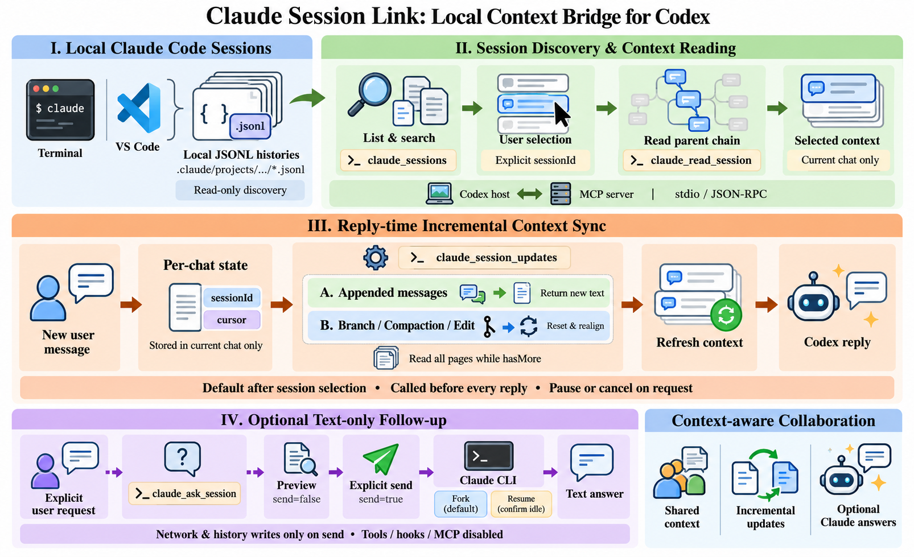

# 🔗 Claude–Codex Session Link

🌍 **[English](README.md) | [简体中文](README.zh-CN.md)**

面向**OpenAI Codex**的**Claude Code会话读取与上下文同步MCP服务器**：发现并读取已保存的Claude对话，在Codex回答前同步新增内容，并在你明确要求时，基于选定会话向Claude继续提问，让跨工具协作融入当前工作流。

项目原名为**Claude Session Link**。

**如果这个项目对你有帮助，欢迎点一个⭐ Star！** 💡欢迎交流想法，🐛欢迎反馈问题，🛠️也欢迎一起改进。


## 🎯 项目动机

**不打断当前工作流，让Codex能够辅助Claude工作。** 无需反复切换窗口、复制粘贴对话历史，在Codex中就能结合Claude已经保存的上下文，梳理任务进展、理解方案选择、分析问题并规划下一步。需要Claude进一步解释时，再明确发送基于选定上下文的文字追问。

## ✨ 核心功能


| 工具 | 用途 | 行为 |
| --- | --- | --- |
| `claude_sessions` | 列出和搜索本机会话 | 只读，返回候选项供用户选择 |
| `claude_read_session` | 读取指定会话 | 只读，沿当前消息父链读取 |
| `claude_session_updates` | 通过游标读取新增或修订的上下文 | 只读，选定会话后在回答前调用 |
| `claude_ask_session` | 在指定上下文中继续进行文字追问 | 默认预览，明确发送后才调用Claude CLI |

- 支持Claude Code终端和VS Code插件保存在本机的会话。
- 会话选择和同步游标仅由当前Codex聊天持有。
- 检测分支切换、上下文压缩和已读正文修订。
- 支持分页读取，以及较长增量消息的连续读取。
- 使用stdio MCP / JSON-RPC，无需启动HTTP服务，也没有运行时npm依赖。

## 🧭 适用场景

- **保持工作流连续：**在Codex中查看Claude Code已经保存的任务进展，无需复制粘贴对话历史。
- **同步最新上下文：**让Codex在回答前读取Claude会话的新增内容。
- **辅助Claude工作：**借助Codex核对方案、分析问题，并在需要时准备向Claude发送的文字追问。

## 🧰 环境要求

- Node.js 22或更高版本；本地读取功能已在Windows验证。
- 当前环境能够访问Claude Code会话文件。
- 实际追问还需要已登录、支持所需安全参数的Claude Code CLI。

默认读取用户目录下的`.claude/projects/<编码后的项目路径>/<会话UUID>.jsonl`。自定义目录可设置`CLAUDE_CONFIG_DIR`或传入`--claude-home`。SSH、WSL或容器内的记录需要在能够访问相应文件的环境中读取。本工具读取Claude Code本地历史，不读取claude.ai网页聊天。

## 🚀 快速开始

```powershell
git clone https://github.com/Dayc-l/claude-codex-session-link.git
cd claude-codex-session-link
node.exe cli.mjs list --limit 10
node.exe cli.mjs list --project C:\Projects\demo --query 缓存
node.exe cli.mjs read --session 完整会话UUID
```

无需运行`npm install`。列出会话、读取、同步和问题预览均在本地完成，不调用模型。

搜索匹配标题、首条提问预览、会话ID和项目路径等元数据，不是历史正文全文搜索。读取默认返回当前父链末尾30条消息；使用`--offset 0 --limit 50`从头分页，或使用`--view all`查看其他已保存历史。默认不输出thinking、图片数据或工具输入输出正文；`--include-tools`仅附带工具元数据。

## 🔌 接入Codex

将以下条目合并到受信任项目的`.codex/config.toml`中，并把示例路径替换为实际安装路径：

```toml
[mcp_servers.claude_session_link]
command = "node.exe"
args = ["C:\\Tools\\claude-codex-session-link\\cli.mjs", "mcp"]
```

保留已有配置，完成后重新加载客户端的MCP连接。也可参考[配置示例](codex-config.example.toml)。辅助脚本默认预览；显式增加`-Apply`才创建项目配置，遇到不同的已有内容会停止：

```powershell
.\scripts\connect-project.ps1 -ProjectPath C:\Projects\demo
.\scripts\connect-project.ps1 -ProjectPath C:\Projects\demo -Apply
```

接入后可以对Codex说：“让我选一个Claude会话。”根据标题、项目路径和时间选择候选项，完整会话ID只在当前聊天中使用。

## 🔄 默认在回答前同步

在当前聊天选定或明确指定Claude会话后，Codex会按照MCP指引，在每次收到用户消息后、回答前调用`claude_session_updates`，直到你明确暂停或取消同步。

首次调用建立最近消息基线，之后传入上次返回的cursor。出现`hasMore=true`时继续取完；出现`resetRequired=true`时根据返回内容重新对齐。切换会话时建立新基线，不沿用旧会话游标。

这一行为依赖宿主遵循MCP指引，由回答前的工具调用触发，不是后台监听或推送服务。只能读取已经写入本地JSONL文件的内容。

对应命令行入口：

```powershell
node.exe cli.mjs updates --session 完整会话UUID
node.exe cli.mjs updates --session 完整会话UUID --cursor 上次返回的cursor
```

## 💬 可选的文字追问

先预览问题，不实际发送：

```powershell
node.exe cli.mjs ask --session 完整会话UUID --question "你为什么选择这个方案？"
```

只有明确需要Claude回答时才增加`--send`：

```powershell
node.exe cli.mjs ask --session 完整会话UUID --question "请解释下一步。" --send
```

默认`fork`模式创建新会话分支，并返回其ID。若要在同一分支连续追问，可对返回的ID使用`resume`；此模式向目标会话追加记录，需要你确认目标空闲：

```powershell
node.exe cli.mjs ask --session 目标会话UUID --mode resume --confirm-idle --question "接着解释。" --send
```

实际发送会联网、消耗Claude额度，并由Claude CLI保存问答。文字追问禁用工具、hooks和MCP。`--confirm-idle`是你的声明，不是自动空闲检测。超时、取消或结果未知时不会自动重发。可用`--expected-version`约束读取后发生的变化，使用`--question-file`传入UTF-8问题文件。

## 🧪 测试与限制

```powershell
node.exe --test test/link.test.mjs
```

本次上传源码的21项离线测试全部通过，使用合成会话和模拟Claude响应。覆盖只读不变性、父链、未写完记录、分页、MCP协议、增量游标、分支切换、压缩、正文修订和长消息续页。

真实登录后的联网追问尚未完成端到端验证；客户端是否自动加载MCP也取决于具体安装环境。详见[验证范围](VALIDATION.md)和[更新记录](CHANGELOG.md)。

解析器针对本机观察到的JSONL格式实现，并非官方内部SDK。已丢弃的历史和未落盘内容无法恢复。完整读取会拒绝超过128 MiB的会话文件；普通读取对单条消息和每页输出设有上限。增量输出支持长消息连续读取。

## 🏗️ 技术架构

<details>
<summary>展开完整技术框架图</summary>



</details>

## 🔒 仓库与数据

本公开仓库仅包含源码、合成测试、文档和框架图。请勿提交真实对话记录、游标、凭据、日志或个人配置。

## 📄 开源协议

本项目采用[MIT开源协议](LICENSE)。`package.json`中的`private: true`用于防止误发布到npm，与GitHub仓库可见性和开源协议无关。

**🌟喜欢这种更顺畅的工作方式？欢迎⭐ Star，让更多需要跨工具衔接上下文的朋友发现这个项目！**
